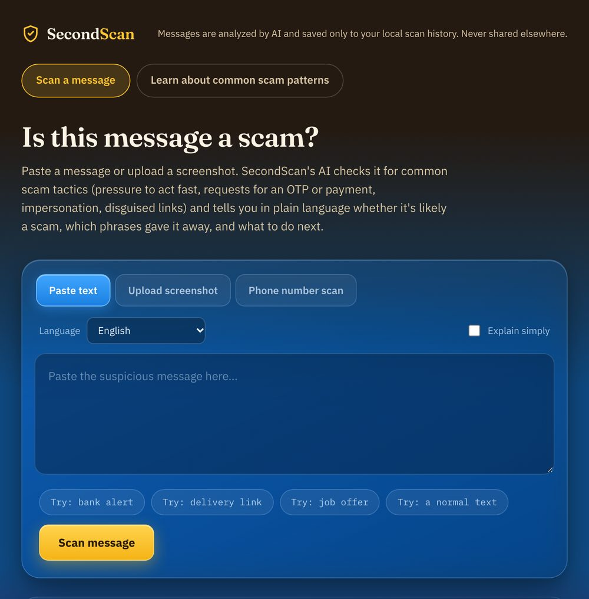
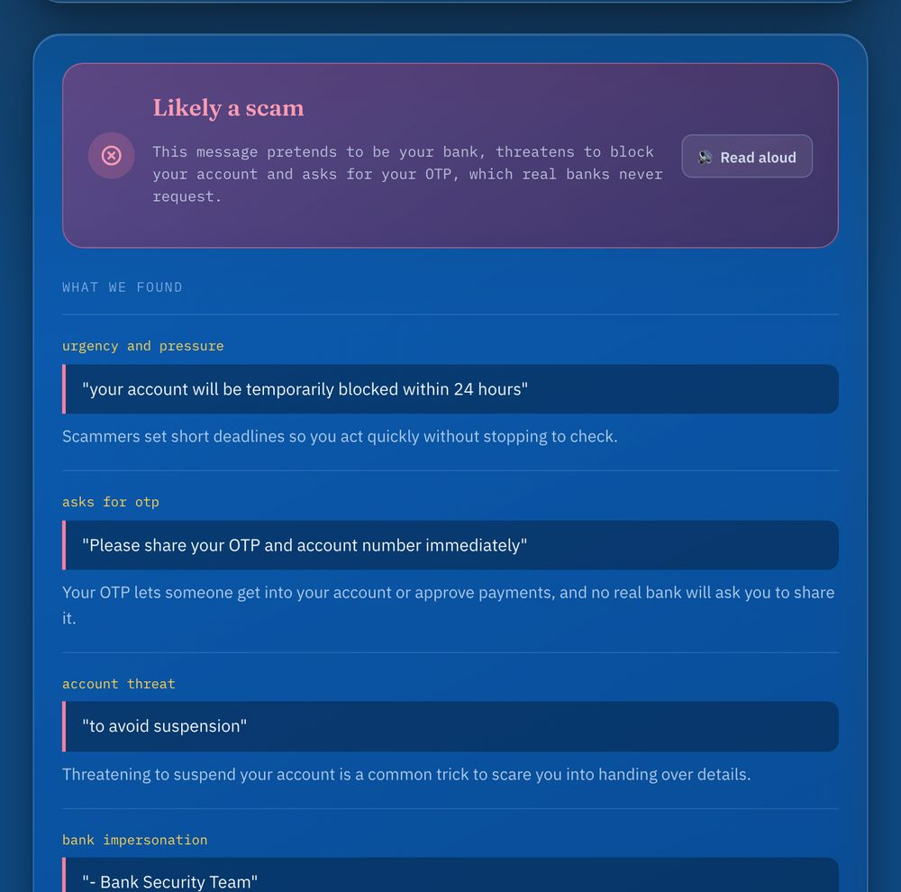
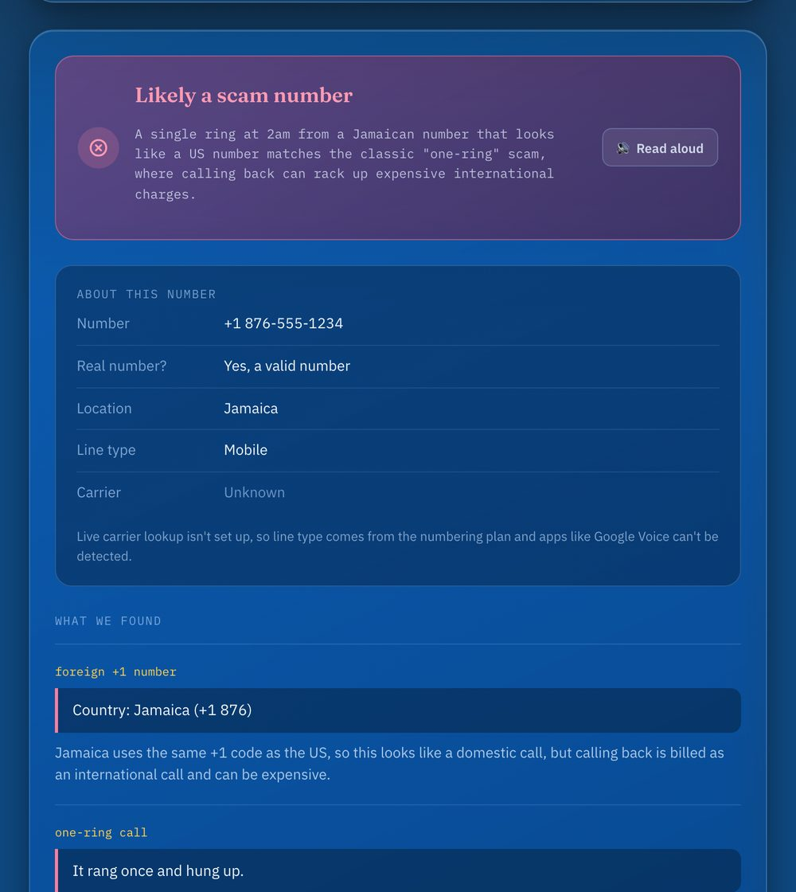
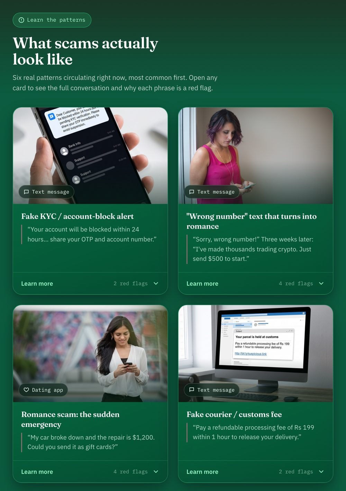
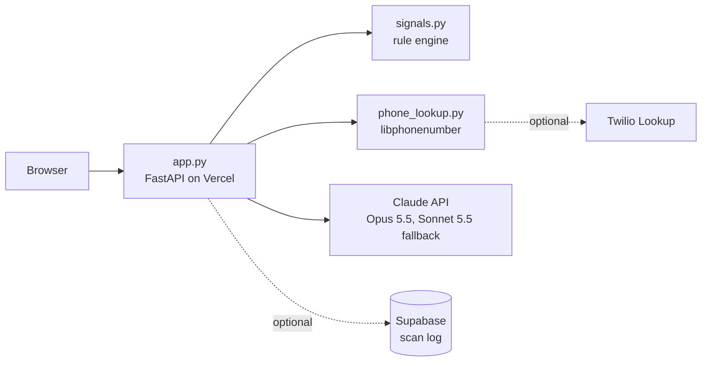

# TruthScan: AI Scam Detection & Protection

**Paste a message, upload a screenshot, or look up a phone number, and find out in plain language whether it's a scam and what to do next.**

**Try it out:** [truthscan-six.vercel.app](https://truthscan-six.vercel.app) · [Common scam patterns](https://truthscan-six.vercel.app/secondscan/patterns)

TruthScan is the scam check and resources page for
[Second Look](https://github.com/AartiDashore/SecondLook), our HuskyHack 2026 project.

<p align="center">
  
</p>

## Inspiration

Scams reach people where they already talk: text messages, WhatsApp, dating apps and phone calls. In the US,
imposter scams (fake banks, agencies and companies) were the most reported fraud for the ninth year running in
2025, with over a million reports and $3.5 billion lost, and investment scams cost people another $7.9 billion. In
India, about three-quarters of the money lost to cyber fraud in 2025 went to investment scams.

Most people never get a second opinion before they reply, click or pay. Second Look pauses a risky payment
before it leaves a member's account. TruthScan is the other half: a place to check the message, screenshot or
phone number behind it, and a page that shows what today's most common scams look like.

## What it does

**Check a message.** Paste any text, email, WhatsApp message or call transcript. TruthScan answers with:

- a verdict: *Looks safe*, *Proceed with caution* or *Likely a scam*, with a one-line reason
- every red flag, quoting the exact phrase from the message and explaining why it's a warning sign
- one concrete next step, and a short safety checklist (never share an OTP or PIN, don't click the link,
  don't install the app, contact the company through its official number)
- for likely scams, the cyber-crime reporting line and website for the country that matches your language

**Check a screenshot.** Upload a screenshot of a text, chat or call screen. Claude reads the text from the image,
then TruthScan checks it the same way.

**Check a phone number.** Enter the number that called or texted you, and optionally what they said or asked for.
TruthScan checks:

- whether it's a real, valid number, and where it's from
- its line type and carrier
- warning signs in the number itself: fictional 555-01XX numbers, premium-rate numbers, and +1 numbers that
  look American but belong to a Caribbean country, the trick behind "one-ring" callback scams
- with a live carrier lookup turned on: whether it's a virtual (VoIP) number from an app like Google Voice or
  TextNow, its current carrier, and the caller ID name registered to it

For US numbers, the result links to people-search sites so you can look up the owner yourself, with a warning
that scammers often spoof real people's numbers.

<p align="center">
  
  
</p>

**Learn the patterns.** The [patterns page](https://truthscan-six.vercel.app/secondscan/patterns) shows six real
scams, most common first: a fake bank KYC alert, a "wrong number" text that turns into a crypto romance, a dating
match with a sudden emergency, a fake courier fee, a part-time job offer, and a "digital arrest" call. Each card
shows a photo and a one-line example; **Learn more** opens the full conversation, where you can tap each
underlined phrase to see why it's a red flag.

<p align="center">
  
</p>

**Built for everyone.** Results in 13 languages (English, Hindi, Bengali, Tamil, Telugu, Marathi, Spanish,
French, German, Portuguese, Arabic, Chinese and Russian), an *Explain simply* mode, read-aloud, and a layout that
works on a phone.

**Privacy.** Messages are sent to Claude to be analysed. Phone numbers are checked against numbering and carrier
records; the number's owner is never contacted. Scans are only stored if a Supabase database is set up.

## How we built it



- **One FastAPI app** (`app.py`) serves the pages and the JSON API, and runs as a single Vercel Function.
- **A rule engine first.** `signals.py` matches ten explicit warning signs (urgency, OTP or PIN requests, gift
  card or crypto payments, bank or government impersonation, links and shortened links, app installs, prizes, job
  offers and account-detail requests) and passes them to the model as hints.
- **Claude decides.** Claude reads the message with those hints and returns structured JSON that matches a fixed
  schema, so every verdict has the same shape. `claude-opus-5-5` runs first, with `claude-sonnet-5-5` as a
  fallback. If both fail, TruthScan still answers from the rules alone and labels the result as lower-confidence.
- **Screenshots** are read with Claude's vision, so there's no OCR binary to install on a serverless host.
- **Phone numbers** go through `phone_lookup.py`: Google's libphonenumber for validity, country, area, line type
  and red flags, plus Twilio Lookup for the live carrier, VoIP detection and caller ID name when it's configured.
  A separate prompt teaches Claude that caller ID can be faked, so what the caller asked for counts for more than
  the number itself.
- **Translations** of the interface are generated by Claude on first use and cached.
- **Supabase** (optional) stores the scan log, feedback and statistics, and powers known-scam matching: a message
  or number flagged before is recognised the next time.
- **The front end** is plain HTML, CSS and JavaScript with no framework.

## Challenges we ran into

- **Finding out who owns a number.** People-search sites block or forbid automated lookups, and scam calls often
  spoof real people's numbers, so scraping them would put innocent people's names next to "Likely a scam." We
  use the registered caller ID name from a licensed lookup instead, and link to the sites so people can search
  themselves.
- **Spotting Google Voice numbers.** US numbers keep their number when they switch carrier, so the numbering plan
  can't tell a mobile from a VoIP number. That takes a live carrier lookup.
- **A clean number proves nothing.** Because caller ID can be faked, the phone check is designed to say so
  whenever it finds no red flags, and to weigh what the caller asked for above the number.
- **Staying useful when the AI isn't.** If Claude is unavailable, a fallback model and then the rule engine
  still give an answer, clearly marked as lower-confidence.
- **Going live.** Our first deploy ran as a static site instead of the Python app, an API key with a trailing
  newline quietly broke every AI call, and the pattern photos weighed 21 MB until we cut them to about 450 KB.

## Accomplishments that we're proud of

- One consistent verdict for three very different inputs: text, screenshots and phone numbers.
- A phone check that catches one-ring callback numbers, premium-rate and fictional numbers without any paid
  service, and spots Google Voice and TextNow numbers when the carrier lookup is on.
- Keeping private people private: no scraping, and the AI is told not to repeat a number owner's name in its
  explanation.
- Accessible by design, with 13 languages, a simple-reading mode and read-aloud.
- It runs with just a Claude API key; every other service is optional.

## What we learned

- Scams are conversations, not single messages. Romance and investment scams build trust for weeks before they
  ask for money, which is why the pattern cards show whole threads.
- Context beats metadata: what a caller asks for says more than the number they call from.
- Respecting a data source's terms changes product design for the better.
- Small details decide whether a demo works live: build presets, how an environment variable is pasted, image
  sizes and browser caching.

## What's next for TruthScan

- Turn on the live carrier lookup in production, for Google Voice detection and caller ID names.
- Turn on scan history and known-scam matching in production.
- Add rate limiting, so a public page can't run up AI costs.
- Translate the patterns page and the phone details, which are English-only today.
- Add more patterns, such as fake toll notices, which helped drive a 40% jump in government imposter reports in
  2025.
- Link to TruthScan from Second Look's "Take another look" button.

## Built with

Python · FastAPI · Anthropic Claude API · Google libphonenumber (`phonenumbers`) · Twilio Lookup (optional) ·
Supabase (optional) · HTML · CSS · JavaScript · Vercel

## Run it yourself

You need Python 3.12 or newer and a Claude API key from [console.anthropic.com](https://console.anthropic.com).

```bash
git clone https://github.com/camyngo/TruthScan.git
cd TruthScan
python3 -m venv .venv && source .venv/bin/activate
pip install fastapi uvicorn anthropic requests python-dotenv python-multipart phonenumbers
cp .env.example .env    # then add your ANTHROPIC_API_KEY
uvicorn app:app --reload
```

Open http://127.0.0.1:8000, which goes straight to TruthScan. `--reload` restarts the server when you save
`app.py`; changes to the pages and `static/` files only need a browser refresh.

| Environment variable | Needed? | What it turns on |
|---|---|---|
| `ANTHROPIC_API_KEY` | Required | All AI analysis |
| `SUPABASE_URL`, `SUPABASE_KEY` | Optional | Scan history, stats, feedback and known-scam matching. Run `supabase/schema.sql` in your project's SQL Editor and use the server-side `service_role` key. |
| `TWILIO_ACCOUNT_SID`, `TWILIO_AUTH_TOKEN` | Optional | Live carrier lookup for phone scans: about $0.018 per scan ($0.008 for line type and carrier, plus $0.01 for the caller ID name, US numbers only) |
| `CLAUDE_MODEL`, `CLAUDE_FALLBACK_MODEL` | Optional | Override the default models |

`.env` is git-ignored, so keys stay on your machine.

### Deploy

The live site is the Vercel project `truthscan`, connected to this repository. Pushing to `main` deploys to
production; pushing any other branch creates a private preview deployment. `vercel.json` selects the FastAPI
preset, and `pyproject.toml` names the entrypoint (`app:app`) and the dependencies. Set the environment variables
above in the Vercel project's settings, and mark the keys as Sensitive.

## API

| Method | Path | Body | Returns |
|---|---|---|---|
| `POST` | `/api/scan` | `{"text", "language", "reading_level"}` | Verdict, summary, findings, next step |
| `POST` | `/api/scan-image` | `{"image": "<data URL>", "language", "reading_level"}` | The same, plus the text read from the image |
| `POST` | `/api/scan-phone` | `{"number", "context", "language", "reading_level"}` | The same, plus the number's details |
| `POST` | `/api/feedback` | Form fields `scan_id`, `was_correct` | `{"ok": true}` |
| `GET` | `/api/log` | | Recent scans (with Supabase) |
| `GET` | `/api/stats` | | Scan counts |
| `GET` | `/api/languages` | | Supported languages |
| `GET` | `/api/ui-strings?lang=` | | Interface text in that language |

`language` is one of the 13 supported languages; `reading_level` is `normal` or `simple`.

## Repository layout

| Path | What it is |
|---|---|
| `app.py` | FastAPI app: pages, API, Claude calls, Supabase logging |
| `signals.py` | Rule engine for message scans |
| `phone_lookup.py` | Phone number facts and risk signals |
| `secondscan.html`, `static/secondscan.*` | Scanner page (`/secondscan`; `/` redirects here) |
| `patterns.html`, `static/patterns.*`, `static/img/` | Common scam patterns page and its photos |
| `supabase/schema.sql` | The `scans` table |
| `screenshots/`, `test-samples/` | Screenshots and example scam messages |
| `prototype.html`, `analysis/`, `deck/` | Second Look prototype, payment scoring and slides; not part of the site |

## Credits

- Adapted from [Tellsign](https://github.com/propcgamer20-png/tellsign)
  ([original write-up on Devpost](https://devpost.com/software/fill-the-blanks-tellsign-ai-scam-detection-protection)).
- Built for [Second Look](https://github.com/AartiDashore/SecondLook), HuskyHack 2026.
- The romance and "wrong number" pattern photos are CC0 public domain, from StockSnap.
- Scam statistics: FTC
  ([imposter scam trends](https://consumer.ftc.gov/consumer-alerts/2026/05/new-trends-reports-imposter-scams),
  [testimony on the scam economy](https://www.ftc.gov/system/files/ftc_gov/pdf/ftc-testimony-jec-hearing-on-the-rising-scam-economy.pdf))
  and I4C data reported by
  [ThePrint](https://theprint.in/india/cybercrime-saw-24-spike-in-2025-indians-lost-rs-22495-crore-mainly-in-investment-scams/2859930/)
  and [Moneylife](https://moneylife.in/article/fraud-alert-india-is-losing-over-22000-crore-a-year-in-cyber-scams-and-the-worst-is-yet-to-come/80612.html).

## License

This repository's [LICENSE](LICENSE) is MIT. Tellsign, which TruthScan is adapted from, is published without a
license.
